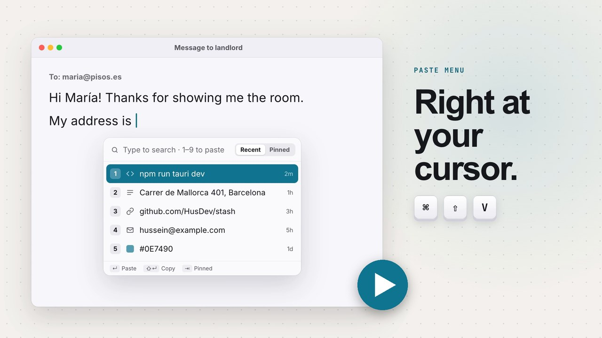

# Stash

A keyboard-first clipboard manager for macOS, built with Tauri 2.

**[Website](https://husdev.github.io/stash/)** · **[Download for macOS](https://github.com/HusDev/stash/releases/latest/download/Stash.dmg)** (Apple Silicon + Intel, macOS 11+) · MIT licensed

[](docs/stash-demo.mp4)

▶ [Watch the 45-second demo (with sound)](docs/stash-demo.mp4). The video was made with [HyperFrames](https://hyperframes.heygen.com); its source is in [`videos/stash-explainer`](videos/stash-explainer).

Press **⌘⇧V** while typing anywhere. A small menu opens at your text cursor with your recent copies. Press **1–9** or **↵** to paste one. Normal **⌘V** still pastes as usual.

For the full window (search, preview, edit, filters), click the menu bar icon or press **⌘O** in the menu.

## Paste menu (⌘⇧V)

| Key | Action |
| --- | --- |
| 1–9 | Paste that item |
| ↑ ↓ ↵ | Choose an item and paste it |
| ⇧↵ | Copy only |
| type | Search |
| ⇥ | Switch between Recent and Pinned |
| ⌘O | Open the full Stash window |
| Esc | Close |

The menu finds your text cursor with the macOS Accessibility API, using the same permission as auto-paste. If an app doesn't report its cursor, the menu opens under the text field or at the mouse.

## Run

```sh
npm install
npm run dev      # development
npm run build    # release build: src-tauri/target/release/bundle/macos/Stash.app
```

For direct paste, give Stash permission in **System Settings → Privacy & Security → Accessibility**. In dev mode, give it to your terminal app instead. Without this permission, ↵ still copies the item, and you press ⌘V yourself.

## Full window

| Key | Action |
| --- | --- |
| type | Search. All the words must match |
| ↑ ↓ / ⌃N ⌃P | Move the selection |
| ↵ | Paste into the previous app |
| ⇧↵ | Copy only |
| ⌘1–9 | Paste one of the first 9 items |
| ⇥ / ⇧⇥ | Next or previous filter (All, Pinned, Text, Links, Images, Code, Colors) |
| ⌘P | Pin or unpin. Pinned items are never trimmed or cleared |
| ⌃⌥1–9 | **From any app, Stash closed:** paste pinned item 1–9, numbered in the order you pinned them |
| ⌃⌥V | **From any app, Stash closed:** paste the copy before your current one (press again to switch back) |
| ⌘E | Edit the text before you paste it (⌘S saves) |
| ⌘⌫ | Delete (⌘Z undoes it) |
| ⌘, | Settings |
| Esc | Clear the search, then reset the filter, then close |

You can turn the ⌃⌥ shortcuts off in Settings → Paste shortcuts. Pinned items show their ⌃⌥ number in the list.

## Notes

- It saves text and images, and records which app each item came from.
- It does not save secrets that password managers mark as concealed (1Password, Bitwarden, etc.).
- You can pause capture from the menu bar icon or from Settings.
- History is stored in `~/Library/Application Support/com.hussein.stash/`.
